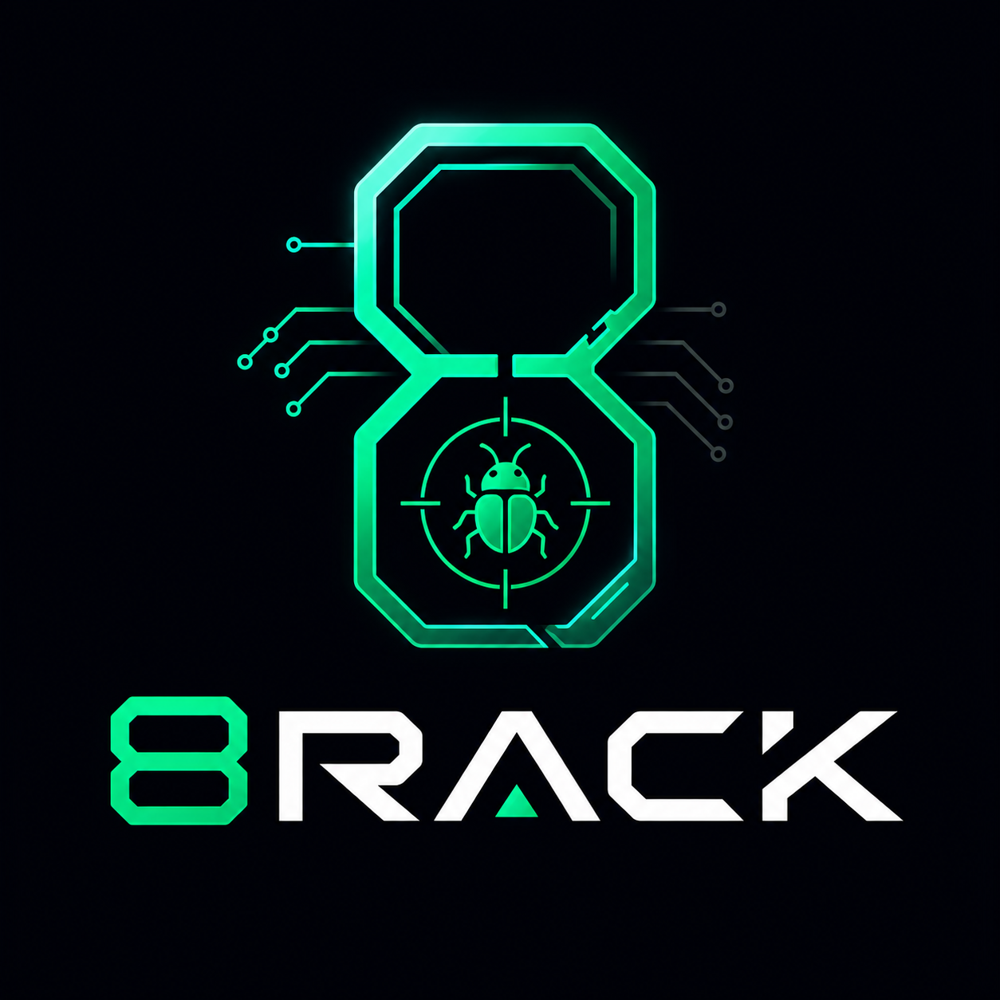

<p align="center">
  
</p>

<h1 align="center">8Rack</h1>

<p align="center">
  A local, no-cloud AI-powered bug bounty factory — built on top of your own
  <a href="https://ollama.com">Ollama</a> models.
</p>

---

8Rack turns an authorized bug-bounty engagement into a Mission that runs through a factory
pipeline — Scope → Recon → Asset Discovery → Enumeration → Analysis → Vulnerability Discovery →
Validation → Evidence → Report → Human Review — with purpose-built agents doing the work, real tool
execution (nmap, ffuf, nuclei, bash, and more) gated behind human confirmation at every step, and a
Factory Director that reads a mission's scope/assets/findings and drives that pipeline forward on
its own between approvals. Everything a mission produces — assets, work orders, findings, evidence,
reports — is scoped to that mission and stays on your machine, with no accounts, no database, and no
cloud storage.

## Features

- **Missions** — one authorized engagement (target/program, scope, out-of-scope, rules of
  engagement) that everything else is scoped to. A mission's `status` tracks its position in the
  factory pipeline (Draft → Ready → Recon → Investigating → Validating → Reporting → Review →
  Completed, plus Paused/Cancelled), auto-advanced by the Factory Director as work completes.
- **Scope Engine** — every tool execution is checked against a mission's configured scope before it
  runs; an out-of-scope target is blocked, explained, and logged to the mission's Activity Timeline
  — centralized in one place, not re-implemented per agent.
- **Asset Inventory** — a real, deduplicated store of everything discovered about a mission
  (domains, subdomains, URLs, IPs, ports, services, APIs, technologies), with a parent/child
  relationship tree (e.g. `example.com` → `api.example.com` → `443` → a REST API) and full
  `firstSeen`/`lastSeen`/`discoveredBy` provenance.
- **Factory Director** — a rule-based planner above the multi-agent orchestrator: reads a mission's
  scope, assets, and findings, creates Security Work Orders (Recon → Enumeration → Validation),
  assigns them to the right agent, and auto-chains through everything that doesn't need your
  approval — pausing exactly where a tool confirmation or validation verdict needs a human.
- **Security Work Orders** — a trackable unit of agent work (objective, target, priority,
  dependencies, related assets/findings) backed by a real Orchestrator task underneath, so a work
  order can request tools and pause for confirmation just like any other agent task.
- **Tool Execution Framework** — ~20 real recon/exec tools (`nmap`, `ffuf`, `nuclei`, `httpx`,
  `subfinder`, `amass`, `bash`, `python`, filesystem ops, and more), each agent restricted to its own
  allowed subset. **Every tool requires explicit human confirmation before it runs**, aggregated into
  a single Approval Queue, and filesystem tools are sandboxed to a configurable workspace root — an
  agent can never touch your machine without you approving it first.
- **Orchestrator** — the autonomous tool-calling loop every Work Order runs on: an agent reasons
  about an objective, requests a tool, pauses for your Approve/Reject, feeds the result back, and
  repeats until it has an answer — with configurable loop-prevention caps.
- **Security Scanners (Scan Profiles)** — chain several recon tools into one named, repeatable scan
  (Quick Recon, Subdomain Discovery, Web App Scan, Full Port Scan) — preview every resolved command,
  confirm once, and the whole chain runs with live per-step progress; a step failing doesn't abort
  the rest.
- **Findings Engine** — tool output is automatically parsed into structured, deduplicated findings
  and correlated into a mission-wide graph (target → port → service/tech → vulnerability). Includes
  an on-demand **CVE lookup** against the public NVD database for any technology finding, and
  AI-powered "explain this finding" triage.
- **Finding Validation** — a Vulnerability Validator agent reviews a potential finding's evidence
  against an explicit checklist (reproducible? in scope? evidence sufficient? impact realistic?
  duplicate? right severity?) and promotes it to Confirmed/False Positive/Duplicate — findings are
  never auto-confirmed.
- **Evidence** — every finding carries its own trace of HTTP requests/responses, terminal output,
  tool results, and agent reasoning behind it, browsable mission-wide.
- **Report generation** — select a set of findings and generate one polished Markdown report
  (executive summary + per-finding impact/reproduction/remediation) via the Report Writer agent,
  tracked through a Draft → AI Generated → Human Review → Ready → Submitted status, with history, an
  in-app viewer, and Markdown export.
- **Knowledge base (RAG)** — index your own workspace codebase locally via an Ollama embedding
  model; agents can search it as a read-only tool.
- **A focused UI** — one mission picked in the sidebar, a Factory Dashboard (pipeline, approval queue,
  live stats) as the default view, and a dark/light theme. Seven top-level views: Factory, Work Orders,
  Assets, Findings, Reports, Agents, Tools.

Everything runs through the backend — the frontend never talks to Ollama directly.

## Default agents

| Agent | Role |
| --- | --- |
| **Planner** | Breaks large objectives into smaller, actionable tasks. |
| **Recon Agent** | Generates reconnaissance strategies and tool commands for authorized targets. |
| **Web Analyzer** | Analyzes HTTP responses, headers, technologies, and potential attack surfaces. |
| **Code Assistant** | Generates scripts, automation, and proof-of-concept code. |
| **Output Parser** | Converts raw tool output into structured findings. |
| **Vulnerability Validator** | Reviews findings, eliminates false positives, and estimates severity. |
| **Report Writer** | Generates professional bug bounty reports with clear reproduction steps and recommendations. |
| **General Assistant** | Answers general cybersecurity and programming questions. |

Agent configs live in `backend/data/agents/*.json` (one file per agent) and are reloaded live —
edit or add one and hit "Reload" in the sidebar, no restart needed.

## Structure

```
8Rack/
├── backend/    # Express + TypeScript API server wrapping the Ollama REST API
└── frontend/   # React + TypeScript + Vite UI
```

See `CLAUDE.md` for a fuller architecture overview and `DEVELOPMENT.md` for the complete build
history and the reasoning behind every non-obvious decision.

## Requirements

- Node.js 20+
- [Ollama](https://ollama.com) running locally (`ollama serve`), default at `http://localhost:11434`

## Getting started

First-time setup:

```bash
cd backend && cp .env.example .env && npm install && cd ..
cd frontend && npm install && cd ..
```

Then, either run both dev servers with one command:

```bash
./start.sh
```

or start them separately:

```bash
# Terminal 1 — backend
cd backend
npm run dev   # http://localhost:3001

# Terminal 2 — frontend
cd frontend
npm run dev   # http://localhost:5173
```

The frontend dev server proxies `/api/*` requests to the backend.

## Configuration

All backend configuration is via `backend/.env` (see `backend/.env.example`):

| Variable | Default | Purpose |
| --- | --- | --- |
| `PORT` | `3001` | Backend port |
| `HOST` | `127.0.0.1` | Interface the backend binds to — loopback-only by default since there's no auth on this app; only widen it (e.g. `0.0.0.0`) if you deliberately want LAN access |
| `ALLOWED_HOSTS` | _(unset)_ | DNS-rebinding defense — Host-header allowlist (comma-separated, each including its port); defaults to `localhost`/`127.0.0.1`/`[::1]` on `PORT` when `HOST` is left at its default, not enforced when `HOST` is set to anything else |
| `OLLAMA_BASE_URL` | `http://localhost:11434` | Where Ollama is running |
| `CORS_ORIGIN` | `http://localhost:5173` | Allowed frontend origin |
| `WORKSPACE_ROOT` | `backend/workspace` | Root that filesystem exec tools and the knowledge base are confined to |
| `MAX_ORCHESTRATOR_TOOL_CALLS` | `10` | Orchestrator loop-prevention cap |
| `MAX_ORCHESTRATOR_TASK_TIME_MS` | `600000` | Orchestrator loop-prevention cap |
| `EMBEDDING_MODEL` | `nomic-embed-text` | Model used to embed the knowledge base — pull it first: `ollama pull nomic-embed-text` |
| `NVD_API_KEY` | _(unset)_ | Optional key for CVE lookups against the NVD database — raises the rate limit from 5 req/30s to 50 req/30s; lookups work fine unauthenticated if left unset |
| `NVD_REQUEST_TIMEOUT_MS` | `15000` | Bounds the outbound NVD CVE-lookup request |
| `OLLAMA_REQUEST_TIMEOUT_MS` | `60000` | Bounds Ollama's quick, non-generation calls (`/api/tags`, `/api/embed`) |
| `OLLAMA_CHAT_IDLE_TIMEOUT_MS` | `300000` | Bounds a streamed `/api/chat` generation by inactivity, not total duration — resets on every token received |
| `MAX_CONCURRENT_EXECUTIONS` | `5` | Global cap on real OS processes spawned at once across every caller (manual requests, Orchestrator tasks, Scan Profiles) |

## Testing

```bash
cd backend && npm test     # Vitest, service-level unit tests
cd frontend && npm test    # Vitest + React Testing Library, hooks + components
```

Typecheck and lint:

```bash
cd backend && npm run typecheck
cd frontend && npx tsc -b && npm run lint
```

## Docs

- `CLAUDE.md` — architecture overview and commands, for quick orientation
- `DEVELOPMENT.md` — full build history and the reasoning behind every non-obvious decision
- `TODO.md` — the current actionable next-steps list
